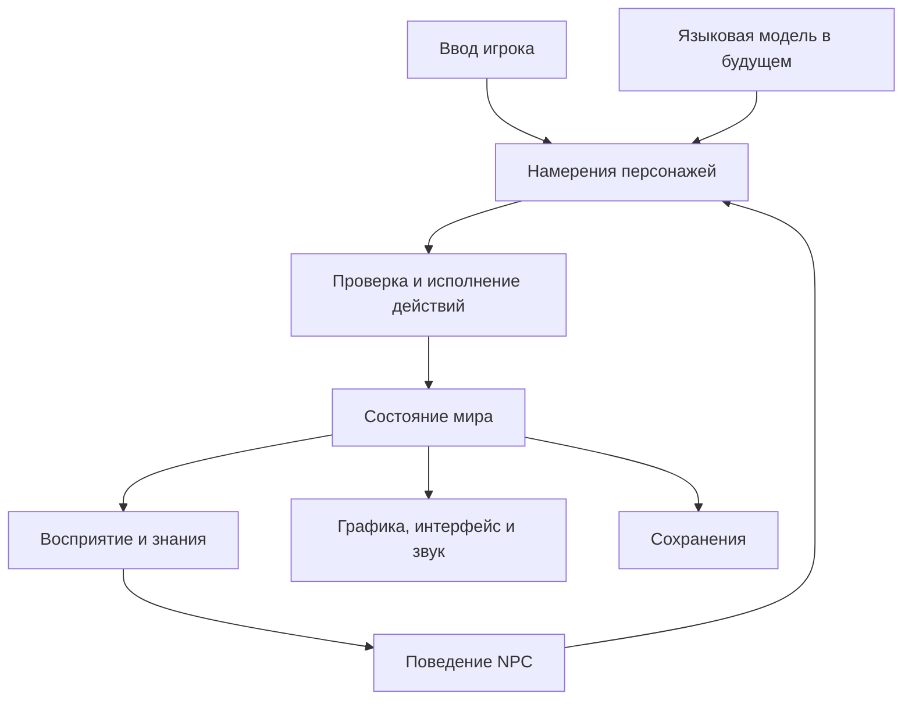

# project-Orvex

## 1. Глобальное видение

### 1.1. Суть игры

Игрок живёт в большой научно-фантастической вселенной и самостоятельно выбирает своё место в ней. Он может стать наёмником, полицейским, инженером, врачом, поваром, перевозчиком, торговцем или исследователем. Профессии отличаются повседневными действиями, необходимыми знаниями, ответственностью и путями развития.

Мир наполнен персонажами, которые работают, потребляют ресурсы, сотрудничают, конкурируют и принимают решения. Игрок становится участником этих процессов. Его действия меняют состояние объектов, отношения людей и доступные возможности; события продолжаются и без его непосредственного вмешательства.

Основной интерес строится на освоении профессии, понимании взаимосвязанных систем и выборе способов достижения собственных целей. Мирная жизнь должна давать самостоятельный игровой опыт: повару не требуется становиться бойцом, чтобы развиваться и участвовать в интересных историях.

**Игровое обещание:** освоить ремесло, выстроить связи и повлиять на жизнь вокруг через собственные решения — от работы в небольшом заведении до участия в конфликтах между организациями.

### 1.2. Мир и масштаб

Вселенная состоит из связанных станций, поселений, корабельных стоянок, промышленных объектов и исследовательских зон. Места различаются условиями жизни, ресурсами, технологиями, населением и местными правилами.

Игрок может менять место проживания и профессию, путешествовать по доступным маршрутам, работать на организации или действовать самостоятельно. Контроль над территориями, доступ к инфраструктуре и отношения между группами создают причины для торговли, сотрудничества и конфликтов.

Огромный масштаб раскрывается постепенно. Каждая новая область должна добавлять содержательные занятия и условия. Бесшовность всей вселенной и управление космическим кораблём требуют отдельного проектирования и не являются обязательными условиями расширения мира.

Сохраняются важные изменения: состояние имущества, результаты контрактов, отношения, известные события и состояние инфраструктуры. Удалённые области могут рассчитываться упрощённо, сохраняя причинность и последствия при возвращении игрока. Подробная симуляция нужна прежде всего там, где персонажи действительно взаимодействуют.

### 1.3. Три взаимосвязанные системы

**В целевой игре должны быть реализованы все три системы:** материальная история вещей, обязательства и доверие, биологическая совместимость и адаптация. Они дополняют друг друга и образуют общую основу профессий.

| Система | Содержание | Влияние на игровой опыт |
|---|---|---|
| Материальная история вещей | Состав, происхождение, состояние, обработка, повреждения и наблюдаемые следы | Работа с качеством ресурсов, ремонт, производство, расследования, оценка снаряжения |
| Обязательства и доверие | Контракты, должностные обязанности, обещания, рекомендации и ответственность | Доступ к работе, отношения с клиентами и организациями, последствия нарушения условий |
| Биологическая совместимость и адаптация | Особенности организмов, питание, травмы, лечение, импланты и взаимодействие со средой | Профессиональная медицина, подходящее питание, подготовка к опасным условиям и изменения тела |

Материальная история хранит значимые изменения объектов. Обязательства определяют, что участники ожидают друг от друга. Биология связывает состояние мира с возможностями и потребностями живых персонажей.

Например, повар проверяет состояние продуктов, выполняет заказ постоянного клиента и учитывает пищевую совместимость его организма. Врач оценивает состояние пациента, выбирает подходящее средство и отвечает за лечение. Наёмник подбирает оснащение и модификации под условия работы, выполняет договор и сталкивается с последствиями своих действий.

На первом этапе реализуется равноправное сочетание материальных следов и обязательств с доверием. Полноценная биология вводится позднее и остаётся обязательной частью дальнейшего развития.

### 1.4. Причинность, информация и последствия

Основная последовательность взаимодействия систем:

**Действие → изменение мира → доступные наблюдения → выводы участников → реакция и новые возможности.**

Фактическое событие, знание о нём и его интерпретация разделяются. Игра может хранить личность похитителя, но NPC узнаёт её только через доступные наблюдения, записи и сообщения. Свидетель может ошибиться, а подозрение не является доказанным фактом.

Следы возникают из событий. Перемещение имущества, повреждение двери, ремонт оборудования или передача предмета оставляют только те сведения, для которых есть источник: сам объект, устройство регистрации или наблюдатель. Всеведущий журнал истории предмета игроку не выдаётся.

Реакции зависят от интересов и знаний конкретной стороны. Заказчик может быть доволен выполнением договора, а полиция — расследовать ту же операцию. Применение силы способно решить непосредственную проблему и одновременно ухудшить отношения с пострадавшими.

Неудача изменяет ситуацию: контракт выполнен частично, имущество повреждено, доверие утрачено, объект временно недоступен. Игра должна поддерживать восстановление после потерь и продолжение истории.

### 1.5. Профессии и деятельность

Каждая профессия получает собственный игровой цикл, пространство решений и связи с другими занятиями.

| Направление | Основные действия | Развитие и связи с миром |
|---|---|---|
| Наёмник | Подготовка и выполнение контрактов: диверсии, рейды, кражи; в дальнейшем другие виды операций | Оснащение, контакты, профессиональная репутация, отношения с заказчиками |
| Полицейский | Патрулирование, предотвращение угроз, реагирование, защита граждан, расследование | Квалификация, служебное доверие, полномочия и инструменты |
| Инженер | Диагностика, обслуживание, восстановление и изменение оборудования | Работа инфраструктуры, надёжность объектов, новые технические решения |
| Врач | Диагностика, стабилизация, лечение, работа с совместимостью и модификациями | Здоровье населения, профессиональное доверие, медицинские услуги |
| Повар | Закупка и проверка продуктов, составление меню, приготовление, обслуживание заказов | Постоянные посетители, пищевые потребности, поставщики и собственное заведение |
| Перевозчик и торговец | Поиск спроса, организация поставок, сохранность груза, сделки | Связи между поселениями, доступность товаров, договоры и репутация |
| Исследователь | Изучение областей, сбор образцов и сведений, проверка свойств находок | Новые знания, материалы и возможности для других профессий |

Профессия не ограничивается выдачей зарплаты за повторение одной операции. Её глубина определяется решениями: что подготовить, какой метод выбрать, на что потратить ресурсы и какую ответственность принять.

Привычные процедуры можно ускорять с опытом, сохранять в виде рецептов или рабочих настроек. Сложность должна возникать из изменения условий и целей, а не из обязательного повторения длинной последовательности кликов.

### 1.6. Персонаж, быт и прогрессия

Персонаж развивается через навыки, знания, оборудование, связи и доступ к новым задачам. Стартовая специализация задаёт первые возможности, но не закрывает другие профессии навсегда.

Смена занятия требует подготовки и подходящего статуса. Боевые навыки не дают полицейских полномочий, а знакомство с медициной не создаёт автоматически доверия пациентов. Известная история поступков сохраняется при переходе между ролями.

Жильё, рабочее место, личное имущество и отношения с окружающими дают долгосрочные цели. Возможность открыть собственное дело или стать частью организации дополняет работу по контрактам и назначениям.

Потребности тела связаны с полноценной биологической системой: разные организмы могут нуждаться в разном питании, лечении и защите. Частота бытовых действий должна оставлять время для выбранной профессии и приключений.

### 1.7. Экономика, инфраструктура и события

Производство, поставки, услуги и потребление связывают профессии. У товаров есть происхождение и состояние; у поставок — получатель и условия; у услуг — потребность и результат.

Неисправность оборудования может остановить работу участка, создать заказ инженеру и изменить доступность товара. Пропажа груза затрагивает перевозчика, клиента, полицию и потенциального исполнителя кражи. Такие цепочки формируют истории из взаимодействия систем.

Инфраструктура включает питание, доступ, рабочие устройства, связь и средства наблюдения. Состояние помещения и окружающей среды влияет на доступность действий и безопасность. Газовая симуляция может рассматриваться как дополнительная система, но не определяет идентичность проекта и не требуется для первого этапа.

Базовую жизнь поддерживают NPC. Отсутствие игрока в одной профессии не должно немедленно останавливать всю экономику. Его вклад выражается в конкретных результатах, качестве услуг и изменении локальной ситуации.

### 1.8. Конфликты, бой и общественный порядок

В мире существуют противоположные интересы и способы их разрешения: переговоры, сделки, расследования, отказ от сотрудничества, скрытые операции и открытые столкновения.

Бой учитывает положение участников, препятствия, видимость, состояние персонажа, боезапас и оснащение. Возможны отход, сдача, задержание и помощь пострадавшему. Цель операции может требовать сохранности объекта или защиты людей, поэтому уничтожение всех противников не является универсальным условием успеха.

Полиция поддерживает порядок и защищает нормальную жизнь. Предотвращённое нарушение — полноценный результат. Необоснованное вмешательство и чрезмерный ущерб влияют на доверие. Наёмник оценивается по условиям договора, но выполнение договора не отменяет последствий для других участников.

### 1.9. NPC как самостоятельные участники мира

NPC должны вести себя как участники тех же игровых процессов, что и человек: работать, выбирать цели, пользоваться предметами, взаимодействовать с коллегами и реагировать на изменение обстоятельств. Это создаёт ощущение населённого мира, в котором каждый занят своим делом.

**Поведенческие требования:**

- **Собственные цели.** Работа, договор, личная потребность или интерес определяют, чем NPC занят в данный момент.
- **Ограниченные ресурсы.** Предметы, доступ, боезапас, здоровье и время влияют на доступные решения.
- **Восприятие и знания.** NPC видит, слышит, получает сообщения и запоминает значимые сведения. Информация может быть неполной или устаревшей.
- **Исполнение действий.** Персонаж достигает результата через действия в мире: приходит к объекту, использует инструмент, переносит имущество, передаёт сведения.
- **Пересмотр плана.** Потеря доступа, появление угрозы, ранение или провал задачи заставляют искать другой вариант, просить помощь, отступать или сдаваться.
- **Социальная память.** Известные поступки влияют на доверие, сотрудничество и отношение к персонажам.
- **Координация.** NPC распределяют простые задачи, сообщают об обнаруженном, поддерживают союзников и учитывают действия партнёров.
- **Самостоятельность.** Доступные работы и события продолжаются без обязательного участия игрока. Союзники могут успешно выполнить часть задачи, противники — воспользоваться промедлением.

Одинаковые действия игрока и NPC должны иметь сопоставимые требования и последствия. NPC не получает предмет из ниоткуда, не узнаёт точное положение цели через стены и не завершает операцию, фактически не выполнив её условия.

Характер, подготовка и склонность к риску могут различать поведение: осторожный сотрудник запросит поддержку, опытный специалист быстрее распознает проблему, исполнитель с низким доверием откажется от дополнительного риска. Ошибки должны вытекать из знаний и условий, а не возникать произвольно ради сложности.

Полная модель поведения развивается постепенно. Для первой карты достаточно небольшого набора целей и действий, но уже с самостоятельным выполнением задач и реакцией на вмешательство.

### 1.10. Возможность подключения ИИ в будущем

У NPC изначально существует обычная игровая система принятия решений. Дополнительно предусматривается возможность подключения языковых моделей — локальных или внешних — для расширения диалогов, интерпретации просьб, работы с памятью и выбора намерений.

Возможные сценарии использования:

- Разговор с персонажем с учётом его личности, знаний, отношений и текущей задачи.
- Обсуждение условий сотрудничества и пояснение причин отказа.
- Понимание просьбы игрока и преобразование её в допустимую игровую задачу.
- Выбор между доступными планами при необычной ситуации.
- Пересказ известных событий и формирование показаний от лица конкретного свидетеля.

**Граница ответственности:** модель предлагает реплику или намерение; игровая система проверяет возможность действия и выполняет его. Проверяются доступ, ресурсы, полномочия, условия задания и текущее состояние мира. NPC должен физически совершить действия, необходимые для результата.

Модель получает только сведения, доступные персонажу. Её реплика не становится автоматически новым фактом мира, подтверждённой уликой или исполненным контрактом. Намеренная ложь и ошибка NPC могут быть частью поведения, но отделяются от фактического состояния симуляции.

Перемещение, стрельба, реакция на непосредственную угрозу и другие частые действия остаются в обычной игровой логике. Обращение к модели используется там, где допустимо ожидание ответа и где оно добавляет пользу.

Игра сохраняет работоспособность без подключённой модели. При задержке, ошибке или недоступности ИИ NPC продолжает действовать через базовое поведение. Подключение моделей не является зависимостью первого прототипа; его ценность проверяется отдельным экспериментом.

### 1.11. Подача и интерфейс

Визуальный ориентир — компактные двумерные пространства с видом сверху в духе Space Station 14. Конкретная графическая стилистика уточняется отдельно. Важны различимые силуэты, читаемые состояния объектов, видимое снаряжение и понятная навигация.

Интерфейс поддерживает осмотр, контекстные действия, инвентарь, цели, сведения и отношения. Он объясняет причину недоступного действия и известный риск, сохраняя неизвестность там, где персонажу ещё недостаёт информации.

Звуки оборудования, движения, тревог и взаимодействий помогают понимать происходящее. Критичные сигналы дублируются визуально. Детальные показатели открываются по запросу, не перегружая основной экран.

### 1.12. Возможность мультиплеера

Первоначальная игра полностью рассчитана на одного человека. Союзники, противники, клиенты и коллеги представлены NPC. В будущем часть этих ролей смогут занимать другие игроки.

Проектирование должно учитывать общие правила действий, одновременный доступ к предметам, владение имуществом, состояние заданий и сохранение последствий. Однако подготовка к расширению не заменяет разработку сетевой части.

Кооператив и большой постоянный мир требуют разных решений. До выбора основных технических ограничений необходимо определить предполагаемый формат сети, отношение к паузе и ускорению времени, сохранениям, подключению и выходу игроков.

## 2. Первые этапы

### 2.1. Цель первого играбельного фрагмента

Создать небольшую карту с выбором стороны — полиция или наёмники. На обеих сторонах присутствуют NPC: при выборе одной стороны её участники становятся союзниками игрока, а другая группа выполняет противоположные задачи.

Начальный фрагмент проверяет три вещи:

1. Интересно ли участвовать в операции вместе с самостоятельными союзниками против действующих противников.
2. Влияют ли материальные следы и известные поступки на решения и результат.
3. Различаются ли игровой опыт наёмника и работа полицейского при общих правилах мира.

### 2.2. Карта и участники

Рабочая основа карты — грузовой терминал космической станции. На карте размещаются общедоступная зона, склад, техническое помещение, полицейский пост, место подготовки наёмников и точки завершения операций. Участники получают несколько путей перемещения и объекты, вокруг которых возникают задачи.

| Выбор игрока | Союзники | Противники | Основная деятельность |
|---|---|---|---|
| Полиция | NPC-полицейские: патрулируют, сообщают, охраняют, помогают при реагировании | NPC-наёмники: готовят и выполняют операцию | Предотвращение угроз, защита объекта и граждан, восстановление порядка |
| Наёмники | NPC-наёмники: участвуют в плане, выполняют согласованные задачи, поддерживают и отходят | NPC-полицейские: патрулируют, обнаруживают нарушения и реагируют | Выполнение контракта, работа с союзниками, преодоление противодействия |

Нейтральные гражданские работают на объекте, перемещаются и реагируют на происходящее. Они могут быть свидетелями или нуждаться в защите. Их присутствие придаёт смысл сохранению порядка и последствиям ущерба.

Внутри стартового сценария стороны имеют противоположные цели. Это не означает постоянную враждебность всех полицейских и наёмников во всей будущей вселенной. Принадлежность к стороне сама по себе не должна заменять наблюдение и основание для конкретной реакции.

### 2.3. Задачи сторон

| Тип операции | Наёмники | Полиция |
|---|---|---|
| Кража | Изъять указанный предмет и передать его в требуемом состоянии | Предотвратить изъятие, защитить имущество либо вернуть его и установить обстоятельства |
| Диверсия | Нарушить работу конкретного технического узла согласно условиям контракта | Обнаружить подготовку, сохранить работоспособность или остановить последствия вмешательства |
| Рейд | Выполнить обозначенную цель открытого нападения и завершить операцию | Защитить людей и объект, остановить нападение и восстановить контроль |

Контракт определяет основную цель, ограничения, подтверждение результата и условия оплаты. Служебное назначение задаёт защищаемый объект, доступные сведения и полномочия.

Результат допускает частичный успех. Наёмник может получить предмет повреждённым; полиция — сохранить объект, но не задержать исполнителя. Успех оценивается по обстоятельствам и обязанностям стороны, а не только по числу побеждённых противников.

Успешное предотвращение завершает или меняет попытку операции. Игра не должна принудительно запускать нападение после того, как условия для него уже устранены.

### 2.4. Минимальное поведение NPC

Для первого этапа достаточно ограниченного набора планов, которые выполняются через реальные игровые действия и меняются при вмешательстве.

**Общее поведение:** наблюдать, перемещаться, взаимодействовать с предметом, обмениваться сообщением, использовать снаряжение, реагировать на угрозу, запрашивать помощь и пересматривать текущую задачу.

**Союзники:** получать простую задачу, сообщать о выполнении или невозможности её выполнить, помогать в столкновении и учитывать сигнал отхода. Минимальный набор взаимодействий с союзником — следовать, ждать, охранять точку, взаимодействовать с обозначенным объектом и отходить. Доступность поручения зависит от роли и полномочий игрока.

**Противники:** продвигаться к своей цели, обнаруживать вмешательство, реагировать на полученную информацию и менять действия при провале плана. Противодействие не ограничивается ожиданием появления игрока в зоне атаки.

**Гражданские:** выполнять простую работу, замечать доступные им события, покидать опасное место и при необходимости сообщать об угрозе.

Если игрок бездействует, NPC всё равно должны продвигать ситуацию к результату. При этом цели и сообщения должны оставлять игроку понятную возможность внести вклад. Обе стороны используют одинаковые ограничения восприятия, взаимодействия и ресурсов.

### 2.5. Минимальный набор игровых систем

| Система | Объём начального фрагмента |
|---|---|
| Управление | Перемещение, столкновения, осмотр и контекстное взаимодействие |
| Предметы | Перенос, передача, экипировка, состояние и принадлежность имущества |
| Окружение | Двери и доступ, один технический узел, несколько объектов задач |
| Информация | Наблюдение, сообщение, тревога; несколько видов следов и записей |
| NPC | Союзники и противники обеих сторон, нейтральные персонажи, простая координация |
| Бой | Ограниченный набор средств, боезапас, здоровье, препятствия, отход |
| Сдача и задержание | Понятные условия прекращения сопротивления и задержания |
| Обязательства | Контракт или назначение, основные и дополнительные условия, частичный результат |
| Отношения | Несколько состояний доверия и подозрения с объяснимыми основаниями |
| Интерфейс | Цель, инвентарь, сведения, сообщения союзников и итог |
| Состояние игры | Перезапуск тестового сценария; сохранение и загрузка для законченного фрагмента |

Полноценная биология, дополнительные профессии, большая экономика, множество локаций, мультиплеер и языковые модели не входят в первый этап. Их будущая реализация учитывается в границах систем, но не блокирует получение играбельного результата.

### 2.6. Порядок сборки первого этапа

Сначала реализуется кража и её предотвращение: один предмет, условия доступа, перенос, наблюдение, союзники и противники, передача результата. Это позволяет проверить полный цикл без большого количества объектов.

Затем добавляется диверсия, использующая состояние технического узла и проверяемый эффект вмешательства. После этого — рейд с базовым боем, защитой, сдачей и задержанием.

Все три типа задач входят в первый этап. Их последовательное добавление позволяет проверять отдельные связи и сохранять работоспособную сборку.

### 2.7. Критерии готовности

- На одной карте можно выбрать любую из двух сторон и пройти каждый тип операции.
- При обоих вариантах у игрока есть действующие NPC-союзники и NPC-противники.
- Союзник способен самостоятельно выполнить поручение или объяснимо сообщить о неудаче.
- Противник выполняет задачу и реагирует на изменения, а не только преследует игрока.
- Действия игрока могут предотвратить происшествие; результат учитывается без обязательного боя.
- Следы соответствуют произошедшему, а NPC реагируют на доступные им сведения.
- Основная цель и соблюдение дополнительных условий оцениваются раздельно.
- Изменения оплаты, доверия и подозрения имеют понятную причину.
- Неудача имеет явный результат и допускает продолжение либо перезапуск.
- Сохранение и загрузка законченного фрагмента восстанавливают объекты, задачи, знания и отношения.

Проверяется не только техническое выполнение условий: игрок должен принимать разные решения при изменении информации, состояния объектов и действий союзников. Если весь интерес сводится к стрельбе, связь обязательств и материальной истории требует доработки.

## 3. Дорожная карта

### 3.1. Последовательность разработки

| Этап | Основная работа | Результат для проверки |
|---|---|---|
| 1. Основа проекта | Уточнить технические ограничения и предполагаемый сетевой формат; собрать тестовую сцену, управление и взаимодействие | Персонаж перемещается, осматривает и использует предметы |
| 2. Общая ситуация и NPC | Подготовить небольшую карту, выбор стороны, союзников и противников; реализовать кражу и предотвращение | Одна задача полностью работает за обе стороны |
| 3. Завершение первого этапа | Добавить диверсию, рейд, бой, сдачу и задержание; связать следы, обязательства и доверие | Все три операции дают полноценный результат и разные варианты прохождения |
| 4. Цельный фрагмент RPG | Добавить сохранения, последовательные задачи, базовое развитие, расходы, отношения и более живой распорядок NPC | Несколько связанных игровых эпизодов с сохраняющимися последствиями |
| 5. Расширение профессий и систем | Развить производство, услуги и материальные свойства; реализовать биологическую совместимость; добавить мирные профессии | Все три основные системы совместно поддерживают разные способы жизни |
| 6. Расширение мира | Добавить связанные локации, поставки, организации, устойчивые события и более разнообразное поведение NPC | Игрок выбирает место и занятие, мир сохраняет причинность между областями |
| 7. Дополнительные режимы | После отдельных проверок интегрировать выбранный формат мультиплеера и полезные возможности языковых моделей | Новые способы участия в мире без потери работоспособности одиночной игры |

Дорожная карта задаёт порядок получения результатов без календарных обещаний. Исследование сетевых требований и эксперимент с языковыми моделями могут проводиться раньше, но не должны блокировать базовую игру. На каждом этапе интерфейс, графика, звук и тестирование развиваются до уровня, необходимого для понятной проверки механик.

### 3.2. Правила командной разработки

- Каждая новая механика описывается через действия игрока и NPC, изменения состояния, ограничения, обратную связь и способ проверки.
- Сначала собирается работающий игровой цикл, затем увеличиваются объём контента и число вариантов.
- Общие правила предметов и последствий используются разными профессиями; специальные действия добавляются там, где создают самостоятельный опыт.
- Отдельно фиксируются факты мира, знания персонажей и решения, принятые на основе этих знаний.
- Для проверки NPC и событий нужны средства наблюдения: текущая цель, известные сведения, причина действия и изменение состояния. Эта информация не обязана быть видна обычному игроку.
- Новый контент не должен требовать обязательного участия человека во всех профессиях. Необходимые роли выполняют NPC.
- Проектирование будущего расширения не должно превращаться в разработку большой инфраструктуры до проверки начального цикла.

### 3.3. Вопросы перед техническим планированием

Технологическая основа проекта — Rust и Bevy с ECS. До распределения задач по реализации нужно определить целевые платформы и управление, версии инструментов и совместимые зависимости, ресурсы команды, требования к сохранениям и ожидаемый формат будущего мультиплеера. Для NPC необходимо выбрать посильное начальное число активных участников и наблюдаемый набор действий; значения уточняются по результатам тестовой сцены.

Решение о конкретной языковой модели, способе её запуска и бюджете принимается после отдельного эксперимента. Базовые профессии, NPC и основной игровой цикл должны оставаться самостоятельными.

## 4. Архитектура

### 4.1. Технологическая основа

Игра разрабатывается на **Rust** с использованием **Bevy**. Основная архитектурная модель — **ECS: Entity, Component, System**. Используется встроенная ECS Bevy; отдельный собственный ECS-фреймворк не требуется.

- **Entity — сущность:** персонаж, предмет, дверь, технический узел или экземпляр контракта.
- **Component — компонент:** данные конкретной сущности, например состояние тела, доступ, положение, принадлежность или текущая задача.
- **System — система:** логика, которая обрабатывает сущности с нужными компонентами, например перемещение, передачу предмета, восприятие или оценку контракта.
- **Resource — ресурс:** общие данные симуляции, например часы мира, настройки, справочники и состояние генератора случайных чисел.
- **Plugin — плагин Bevy:** регистрация компонентов, ресурсов, систем и их зависимостей для отдельной области игры.

Набор компонентов определяет возможности объекта. Профессия не становится отдельным классом персонажа с копией логики движения, инвентаря и боя.

Конкретные версии Rust, Bevy и сторонних библиотек фиксируются при создании проекта. Для командной сборки хранятся `Cargo.lock` и файл выбранного Rust toolchain. Обновление движка выполняется отдельной задачей с проверкой совместимости. Этот документ не закрепляет номер версии или готовый набор сторонних плагинов.

### 4.2. Разделение ответственности

Архитектура разделяет симуляцию, источники намерений, представление и внешние интеграции.

**Симуляция** является источником истины о положении объектов, состоянии предметов и результатах действий. **Представление** отображает доступное игроку состояние; оно не определяет факт попадания, передачи имущества или завершения задания.

**Контроллеры** предлагают действия от лица персонажей. Они не изменяют целевые игровые данные в обход правил. NPC, ввод игрока и будущие внешние интеграции используют общий путь проверки действия.

Логику симуляции нужно запускать без окна, графики и аудио для тестирования. На старте она остаётся в одном приложении с представлением; отдельный сервер и сложная межпроцессная инфраструктура не нужны.

### 4.3. Организация кода и модулей

Начальная структура — один Cargo-пакет с библиотекой игровых модулей и исполняемой точкой входа. Логические области оформляются как Rust-модули и плагины Bevy. Выделение отдельных crates выполняется при появлении реальной потребности в независимых сборках или повторном использовании.

| Модуль | Ответственность |
|---|---|
| `simulation` | Время симуляции, порядок этапов, общие идентификаторы и жизненный цикл мира |
| `world` | Карта, пространственные запросы, препятствия, двери и технические устройства |
| `actors` | Состояние персонажей, способности, управление движением, сторона и полномочия |
| `items` | Предметы, размещение, экипировка, передача, целостность и материальные свойства |
| `actions` | Намерения, проверки, исполнение, прерывание и результаты действий |
| `combat` | Применение оружия, попадания, повреждения, сдача и задержание |
| `knowledge` | Восприятие, следы, сообщения, память и известность событий |
| `social` | Контракты, назначения, условия результата, доверие и подозрение |
| `npc` | Выбор целей, планы, координация, запросы навигации и исполнение задач |
| `presentation` | Пользовательский ввод, камера, графика, интерфейс, звук и визуальная обратная связь |
| `persistence` | Схема сохранений, стабильные ссылки, загрузка и миграции данных |
| `content` | Описания предметов, профессий, задач и начальных сцен; проверка ссылок и параметров |

Это границы ответственности, а не требование сразу создавать весь объём кода. Модули будущей биологии, сетевого режима и языковых моделей подключаются по мере разработки соответствующих функций.

Интерфейс и конкретный способ управления не входят в зависимости правил мира. Общие типы размещаются в небольшом согласованном слое; не следует превращать его в хранилище всей логики проекта.

### 4.4. Модель сущностей и данных

Ниже приведены проектные названия компонентов, а не готовые типы API Bevy.

| Объект | Примеры данных |
|---|---|
| Персонаж | `PersistentId`, `SimPosition`, `Faction`, `Capabilities`, `Health`, `ControlSource`, `CurrentAction` |
| NPC | Общие данные персонажа плюс `Goal`, `Plan`, `Knowledge`, `SquadMembership` |
| Предмет | `PersistentId`, `ItemDefinitionId`, `ItemLocation`, `LegalOwner`, `Condition` |
| Устройство | `PersistentId`, `DeviceState`, `AccessPolicy`, параметры взаимодействия |
| След | Источник, место, время, наблюдаемые признаки и ссылки на связанные объекты |
| Контракт или назначение | Участники, цель, ограничения, прогресс, подтверждение результата и состояние расчёта |

Источник управления и сторона разделяются. Смена выбора игрока не требует создания специального типа «игровой полицейский» или другой реализации оружия. Полномочия и доверие также не выводятся автоматически только из принадлежности к стороне.

Местоположение предмета имеет одно основное представление: в мире, в контейнере либо в слоте персонажа. Право собственности хранится отдельно от фактического размещения. При краже меняется положение и держатель предмета, но законный владелец не переписывается автоматически. Списки содержимого и прочие индексы должны согласованно выводиться из основного состояния или обновляться одной операцией.

`Transform` графического объекта может использоваться для отображения и интерполяции. Позиция, по которой считаются столкновения, дистанция и взаимодействия, относится к симуляции. Связи владения и контейнеров не следует автоматически приравнивать к иерархии визуальных объектов.

Описание типа предмета отделяется от экземпляра: справочник хранит базовые свойства, экземпляр — конкретное состояние. Карты, условия задач и наборы оснащения задаются данными там, где это облегчает создание контента. Формат данных выбирается при реализации загрузки.

### 4.5. Единый путь действий

Игрок и NPC формируют типизированные намерения: переместиться, взаимодействовать, взять, передать, применить снаряжение, сдаться или задержать. Каждое намерение содержит исполнителя, цель, параметры и идентификатор запроса.

**Намерение → проверка условий → выполнение → результат → наблюдаемые последствия.**

Проверяются существование цели, возможность действия, дистанция, доступ, состояние персонажа и необходимые ресурсы. Для длительного действия сохраняются прогресс и условия прерывания. Изменение мира во время выполнения может отменить действие или потребовать повторной проверки.

Конкурирующие действия разрешаются явно: два персонажа не должны одновременно получить один предмет. Проверка и изменение критичного состояния выполняются согласованно; для длительного использования общего устройства при необходимости вводится резервирование.

У действия есть результат — успех, отказ, прерывание или частичное выполнение с причиной. Данные о выплате и завершении контракта защищаются от повторного применения одного результата.

Игровое намерение не следует путать с `Commands` Bevy: `Commands` служит техническим механизмом изменений ECS, а разрешённость игрового действия определяют системы проекта.

### 4.6. Время и порядок систем

Основная симуляция работает с фиксированным шагом в `FixedUpdate`. Представление и интерфейс обновляются в кадровых расписаниях. Частота симуляции определяется по требованиям к управлению, бою и производительности; она не задаётся произвольным целевым значением в концепции.

Ввод собирается перед выполнением фиксированных шагов. Однократные команды сохраняются до обработки и не повторяются при нескольких шагах за кадр. Удерживаемое направление движения хранится как текущее состояние управления. Пауза и кадры без шага симуляции не должны приводить к потере команды.

Логические этапы одного шага:

1. Принять готовые команды и использовать сведения, доступные персонажам к началу шага.
2. Обновить намерения NPC, которым требуется новое решение.
3. Проверить и выполнить действия, движение и боевые взаимодействия в согласованном порядке.
4. Зафиксировать результаты, изменения объектов и возможные следы.
5. Обновить восприятие и доставить сообщения; новые знания доступны для последующих решений.
6. Обновить условия задач и отношения с учётом требуемого подтверждения результата.

Этапы оформляются через наборы систем и явные зависимости. При структурных изменениях ECS учитывается отложенное применение `Commands`: следующая система должна видеть уже применённые данные, если от них зависит её результат.

Независимые системы могут выполняться параллельно. Конфликт доступа к данным предотвращает небезопасный одновременный доступ, но не задаёт нужный игровой порядок автоматически. Фиксированный шаг также не гарантирует детерминированность: воспроизводимость зависит от генератора случайных чисел, разрешения конфликтов, порядка вычислений и других деталей реализации.

### 4.7. Сообщения, следы и знания

Нужно различать три формы информации:

| Форма | Назначение | Время жизни |
|---|---|---|
| Техническое сообщение | Передать результат между системами | Кратковременное |
| Факт или состояние мира | Хранить значимый результат, след либо прогресс | До завершения установленного жизненного цикла |
| Знание персонажа | Представить полученные сведения, источник и степень уверенности | До забывания, уточнения или завершения истории |

Для обмена между системами используются типизированные средства Bevy. Буферизованные `Message` и реакции `Event`/observers имеют разные назначения; конкретный механизм выбирается под порядок обработки. Краткоживущие сообщения не являются архивом улик, памятью NPC или гарантированной очередью длительных заданий.

Техническое уведомление о краже не передаётся автоматически всем NPC. Оно может изменить состояние имущества, создать доступный наблюдению след и затем привести к обновлению знаний конкретного персонажа. При расчёте отношений учитывается путь получения сведений.

Не требуется сохранять полную историю всех действий мира. Для первого этапа достаточно текущего состояния, значимых следов, прогресса задач и ограниченной памяти. Развёрнутый журнал исполнения допустим как инструмент отладки.

### 4.8. NPC и подключение языковых моделей

Базовая цепочка NPC: восприятие → знания → выбор цели → план → намерение → результат → пересмотр плана. Начальная реализация может использовать ограниченные состояния и подготовленные планы. Переход к более сложному планированию оправдан только тогда, когда текущая модель мешает нужному поведению.

Обновление решений распределяется по времени: немедленная реакция на угрозу, периодическая оценка обстановки, более редкий выбор долгосрочной цели. Навигация использует состояние карты и доступ персонажа; изменение препятствия должно позволять перестроить путь или сообщить о невозможности задачи.

Будущий адаптер языковой модели получает снимок разрешённых знаний и возвращает структурированное предложение реплики или намерения. Он не получает прямой доступ к изменению ECS-мира.

Запросы выполняются асинхронно, без блокирования игрового шага. Ответ связывается с персонажем, запросом и актуальной сессией мира. После загрузки сохранения, удаления персонажа или изменения задачи устаревший ответ отклоняется либо повторно проверяется. Неподдерживаемое действие и недоступная цель дают контролируемый отказ; NPC продолжает базовое поведение.

### 4.9. Сохранения и устойчивые ссылки

Внутренний `Entity` Bevy используется для ссылок внутри текущего ECS-мира. Для сохранений, истории и будущей сети вводится собственный стабильный `PersistentId`: внутреннее представление `Entity` не является долговременным форматом проекта.

Сохранение содержит версию схемы, время мира, необходимые состояния объектов, отношения, знания, задачи и состояние случайности. Ссылки записываются через постоянные идентификаторы. При загрузке сначала создаются сущности, затем восстанавливаются связи и производные индексы.

Снимок формируется на согласованной границе игрового шага. Ассеты, кадры анимации, навигационные кеши, сетевые соединения и выполняющиеся внешние запросы не копируются как часть логического состояния. Необходимые длительные действия сохраняются в явной форме или корректно отменяются по правилам загрузки.

Формат сериализации и миграции контролируются проектом. Возможности отражения и сцен Bevy можно использовать для инструментов и контента, но сами по себе они не определяют совместимость игровых сохранений между версиями.

### 4.10. Подготовка к мультиплееру и расширению

Для будущей сети закладывается модель, в которой авторитетная симуляция проверяет намерения и принимает изменения мира. В одиночной игре она выполняется локально; в сетевой версии эту роль сможет выполнять сервер или хост.

Будущий клиент отправляет запрос действия, а не готовое утверждение о полученной награде или новом владельце предмета. Состояние, передаваемое клиенту, должно учитывать доступность информации; скрытые знания NPC и внутренние факты мира не рассылаются всем участникам автоматически.

Сетевой транспорт, репликация, предсказание движения и восстановление после разрыва связи требуют отдельных решений после выбора режима. ECS и общий путь действий облегчают выделение границ, но не обеспечивают мультиплеер автоматически.

Новые профессии добавляют наборы возможностей, контент, условия задач и специальные действия. Биологическая система позже расширяет состояние организма и обработку эффектов. Она должна взаимодействовать с действиями и восприятием через согласованные интерфейсы, без создания отдельной копии персонажа.

### 4.11. Проверка архитектуры и ближайшая реализация

Первый технический результат — тестовая карта, где игрок и NPC через общий путь действий могут переместить один предмет, заметить результат и выполнить либо сорвать условие задачи. Затем добавляются остальные операции, как описано в разделе 2.

Для основных правил нужны проверки без графики:

- Два персонажа одновременно пытаются забрать один предмет: предмет остаётся у одного держателя.
- NPC без наблюдения или сообщения не получает знание о нарушении.
- Предотвращённая операция не продолжает выполняться по устаревшему плану.
- Повторная обработка результата не выдаёт награду повторно.
- Сохранение и загрузка восстанавливают владельца, местоположение, знания и прогресс задачи.
- Устаревший ответ языковой модели не меняет загруженный или уже изменившийся мир.

Последняя проверка добавляется при реализации интеграции с моделью. Количество компонентов и систем само по себе не является показателем качества архитектуры. Приоритет — ясные границы, проверяемые правила и возможность расширять работающий игровой цикл.

### 4.12. Документация Bevy

Проектные модули и названия компонентов в этом разделе описывают архитектуру игры. Официальная документация ниже служит основанием для используемых возможностей движка. При реализации ссылки следует сверять с закреплённой версией зависимости.

- [ECS: сущности, компоненты и системы](https://bevy.org/learn/quick-start/getting-started/ecs/).
- [Плагины и модульное построение приложения](https://bevy.org/learn/quick-start/getting-started/plugins/).
- [Расписания, зависимости и применение отложенных изменений](https://docs.rs/bevy/latest/bevy/ecs/schedule/index.html).
- [Фиксированный шаг и отделение представления от симуляции](https://bevy.org/examples/movement/physics-in-fixed-timestep/).
- [Время жизни буферизованных сообщений](https://docs.rs/bevy/latest/bevy/ecs/message/struct.Messages.html).
- [Entity: идентификаторы и ограничения устойчивости](https://docs.rs/bevy/latest/bevy/ecs/entity/struct.Entity.html).